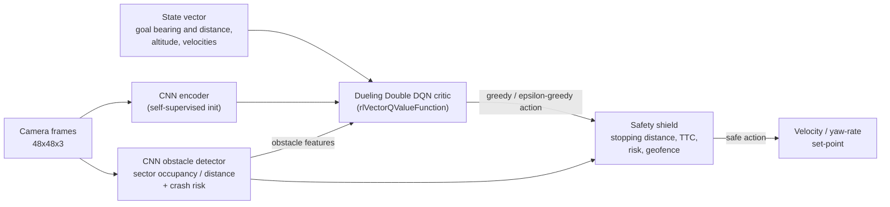
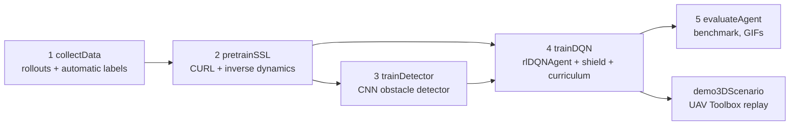

# Autonomous UAV Visual Navigation Using Reinforcement Learning (MATLAB)


A quadrotor visual-navigation system built entirely in **MATLAB**. It combines
**Deep Q-Learning (DQN)**, **self-supervised representation learning** and **CNN-based obstacle detection**,
and adds explicit **navigation and collision-avoidance logic** for environments with moving obstacles.

The UAV must reach a 3D goal using a forward-facing camera, the goal direction, its altitude and its velocity.
All simulation runs in MATLAB:

* a custom **Reinforcement Learning Toolbox environment** (`rl.env.MATLABEnvironment`) with a vectorised
  ray-casting camera, first-order flight dynamics, wind, static pillars and moving obstacles;
* **Deep Learning Toolbox** custom training loops for the self-supervised encoder and the obstacle detector;
* **Reinforcement Learning Toolbox** `rlDQNAgent` (Double DQN, n-step returns, prioritised replay) for the policy;
* **UAV Toolbox** `uavScenario` for 3D replays of the flights.

---

## Highlights

| Component | Implementation |
|---|---|
| **Simulator** | `UAVNavEnv` - 50 m arena, static pillars (some can be over-flown), moving obstacles that cut across the flight path, ground/walls/ceiling geofence, gray **or** depth camera (48x48, 3-frame stack), domain randomisation, curriculum |
| **CNN obstacle detector** | Predicts per-sector **occupancy** and **distance** on a 3 x 5 image grid plus a **crash-risk** probability. Trained only on automatically generated labels (depth buffer + crash events) |
| **Self-supervised learning** | Encoder pre-training with **CURL** (contrastive, momentum key encoder, bilinear similarity) + **inverse dynamics**; crash-risk labels from the UAV's own crashes ("learning to fly by crashing") |
| **DQN agent** | `rlDQNAgent` with **Double DQN**, **dueling** critic (custom `functionLayer`), **n-step** returns, **prioritised replay** (`rlPrioritizedReplayMemory`), image + state inputs, CNN initialised from the self-supervised encoder |
| **Collision avoidance** | `SafetyShield`: stopping-distance rule, **time-to-collision** from closing-speed estimates (moving obstacles), learned crash risk, geofence and a fallback. Applied as a *post-posed shield* inside the environment |
| **Baselines and evaluation** | VFH-style reactive planner, random policy; seeded benchmark (success, collision, time-out, SPL, clearance, shield interventions); GIFs, training plots and a 3D UAV Toolbox replay |

## Architecture





Equations, network layers and shield rules: [`docs/method.md`](docs/method.md).

## Requirements

* MATLAB **R2024a** or newer
* Reinforcement Learning Toolbox and Deep Learning Toolbox (required)
* UAV Toolbox (3D replay with `uavScenario`)
* Parallel Computing Toolbox + NVIDIA GPU (optional; set `cfg.useGPU = true`)
* About 4 GB free RAM for the default replay memory (30k experiences of 48x48x3 images)

## Quick start

From the project folder in MATLAB:

```matlab
setupProject                          % adds folders to the path, checks toolboxes
runtests("tests/testSimulator.m")     % simulator unit tests (seconds)
runtests("tests/testNavigation.m")    % shield / planner tests (seconds)
demoSimulator                         % live simulation + GIFs in results/ (no training needed)
demo3DScenario                        % 3D replay of a flight in a UAV Toolbox scenario
```

Then check that the whole learning pipeline runs on your machine:

```matlab
runtests("tests/testLearning.m")      % networks, losses, tiny end-to-end training (a few minutes)
```

## Training

```matlab
setupProject
cfg = defaultConfig();          % or quickConfig() for a fast check, dynamicHardConfig() for crowded scenes
collectData(cfg);               % 1. ~60k labelled frames         -> data/rollouts.mat
pretrainSSL(cfg);               % 2. self-supervised encoder      -> checkpoints/encoder_ssl.mat
trainDetector(cfg);             % 3. CNN obstacle detector        -> checkpoints/detector.mat
trainDQN(cfg);                  % 4. DQN (Training Monitor opens) -> checkpoints/uav_dqn_agent.mat
evaluateAgent(cfg);             % 5. benchmark + GIFs             -> results/
```

or run the script `runAll` (set `useQuickSettings = true` inside it for a smoke test first).
A GPU is recommended for step 4.

Any parameter can be changed before a step runs:

```matlab
cfg = defaultConfig();
cfg.dqn.maxEpisodes = 4000;
cfg.env.nDynamic = [2 8];
cfg.useGPU = true;
trainDQN(cfg);
```

### Ablations

| Question | Change |
|---|---|
| Perfect perception (upper bound) | `cfg.perception.source = "oracle";` |
| Without the safety shield | `cfg.shield.enabled = false;` |
| Without self-supervised pre-training | delete or rename `checkpoints/encoder_ssl.mat` before steps 3-4 |
| Without detector features in the Q-network | `cfg.perception.useFeatures = false;` |
| Plain (non-dueling) critic | `cfg.model.dueling = false;` |
| Depth camera instead of monocular | `cfg.env.camera.obsMode = "depth";` (re-run steps 1-4) |

## Evaluation

`evaluateAgent(cfg)` runs every policy on the **same seeded scenarios** and writes
`results/<experiment>_evaluation.csv`, a `.mat` file with all trajectories, and one GIF per policy:

* **success rate** - goal reached; **collision rate** - obstacle, ground, wall or ceiling hit;
  **time-out rate** - neither within 80 s
* **SPL** - success weighted by straight-line distance / flown path length
* mean minimum clearance, steps to the goal, shield interventions per episode

Policies: `dqn_shield` (full system), `dqn`, `reactive_shield`, `reactive`, `random`. Append `@oracle` to use
ground-truth sector distances instead of the CNN detector, e.g.

```matlab
evaluateAgent(cfg, Policies=["dqn_shield" "dqn_shield@oracle" "reactive_shield"], Episodes=100);
```

### Results

Fill in after training (`results/uav_dqn_evaluation.csv`):

| Policy | Success | Collision | Time-out | SPL | Mean min. clearance [m] |
|---|---|---|---|---|---|
| `dqn_shield` | | | | | |
| `dqn` | | | | | |
| `reactive_shield` | | | | | |
| `reactive` | | | | | |
| `random` | | | | | |

## Repository structure

```
uav-visual-nav-rl-matlab/
├── setupProject.m               # path setup + toolbox check
├── config/                      # defaultConfig, quickConfig, dynamicHardConfig
├── src/
│   ├── env/                     # UAVNavEnv (RL Toolbox env), world generation, ray-cast camera, movers
│   ├── navigation/              # SafetyShield, sector geometry, reactive (VFH-style) planner
│   ├── perception/              # CNN detector inference, oracle perception
│   ├── learning/                # networks, CURL/inverse-dynamics loss, detector loss, DQN agent, dataset
│   ├── pipeline/                # collectData, pretrainSSL, trainDetector, trainDQN, evaluateAgent
│   ├── eval/                    # runEpisode, policies, evaluatePolicies, metrics
│   ├── viz/                     # SimViewer (live view), GIFs, training plots, UAV Toolbox 3D replay
│   └── utils/
├── scripts/                     # demoSimulator, demo3DScenario, runAll
├── tests/                       # matlab.unittest tests
└── docs/method.md
```

## Design notes

* **Why a custom MATLAB environment plus `uavScenario` for replay?** DQN needs hundreds of thousands of camera
  frames. The vectorised ray caster renders a 48x48 frame in about a millisecond. The UAV Toolbox scenario is
  used to replay and present the learned flights in 3D.
* **Post-posed shield.** `rlDQNAgent` has no action masking, so the shield runs inside the environment. If the
  agent picks an unsafe action, the environment executes the best safe action and adds a small penalty. The
  agent learns to stop choosing unsafe actions, and safety is enforced during both training and deployment.
* **Memory.** Observations use single precision. If your release ignores the `DataType` option of
  `rlNumericSpec`, they fall back to double: halve `cfg.dqn.bufferLength` or reduce the image size.

## Troubleshooting

| Symptom | Fix |
|---|---|
| Error while building the critic mentioning `functionLayer` | `cfg.model.dueling = false;` |
| Out of memory during `trainDQN` | lower `cfg.dqn.bufferLength` (e.g. 15000) or `cfg.env.camera.imgSize` (e.g. 40) |
| `PerceptionSource "detector" needs a trained detector` | run `trainDetector(cfg)` or set `cfg.perception.source = "oracle";` |
| Training is slow | `cfg.useGPU = true;` (Parallel Computing Toolbox) or `cfg.dqn.plots = "none";` |
| `uavScenario` not found | the 3D replay needs UAV Toolbox; everything else works without it |

## References

* V. Mnih et al., "Human-level control through deep reinforcement learning", *Nature*, 2015.
* H. van Hasselt, A. Guez, D. Silver, "Deep Reinforcement Learning with Double Q-learning", *AAAI*, 2016.
* Z. Wang et al., "Dueling Network Architectures for Deep Reinforcement Learning", *ICML*, 2016.
* T. Schaul et al., "Prioritized Experience Replay", *ICLR*, 2016.
* M. Laskin, A. Srinivas, P. Abbeel, "CURL: Contrastive Unsupervised Representations for Reinforcement Learning", *ICML*, 2020.
* D. Gandhi, L. Pinto, A. Gupta, "Learning to Fly by Crashing", *IROS*, 2017.
* J. Borenstein, Y. Koren, "The Vector Field Histogram - Fast Obstacle Avoidance for Mobile Robots", *IEEE T-RA*, 1991.
* M. Alshiekh et al., "Safe Reinforcement Learning via Shielding", *AAAI*, 2018.

## License

MIT - see [LICENSE](LICENSE).
